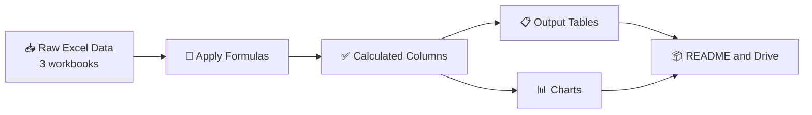

[README (15).md](https://github.com/user-attachments/files/33927833/README.15.md)
<div align="center">

[](https://drive.google.com/file/d/1ci9A9FnO0RbIGl-aDHzRzTsN3kj2L2F9/view?usp=sharing)

# 🚀 Fundamental Booster

### Master the core Excel functions through three hands-on mini projects


🔗 **Download / view the project:** [Google Drive Link](https://drive.google.com/file/d/1ci9A9FnO0RbIGl-aDHzRzTsN3kj2L2F9/view?usp=sharing)

</div>

---

## 📑 Table of Contents

1. [Problem Statement](#-problem-statement)
2. [Objectives](#-objectives)
3. [Technologies Used](#-technologies-used)
4. [Program Flow](#-program-flow)
5. [Project 1 – Student Result Sheet](#-project-1--student-result-sheet)
6. [Project 2 – Sales Records](#-project-2--sales-records)
7. [Project 3 – Employee Records](#-project-3--employee-records)
8. [Key Insights](#-key-insights)
9. [Project Structure](#-project-structure)
10. [Author](#-author)

---

## 🎯 Problem Statement

Beginners often learn Excel functions in isolation and struggle to apply them to real data. Teachers, sales managers and HR teams all need to turn raw tables into **meaningful results** such as grades, regional totals and service years, without calculating anything by hand.

**Fundamental Booster** solves this with three realistic datasets, each built around a different group of Excel formulas:

| # | Scenario | Problem to solve |
|---|----------|------------------|
| 1 | 🎓 Student marks | Calculate each student's total score and assign a grade automatically |
| 2 | 🛒 Sales data | Summarise sales by region and product, and look up specific records |
| 3 | 👔 Employee data | Calculate years of service and extract or look up text and values |

---

## 🏆 Objectives

- ✅ Practise **core Excel formulas** on real-looking data
- ✅ Automate **total score and grade** calculation with `SUM` and nested `IF`
- ✅ Summarise data with conditions using **`SUMIFS`**
- ✅ Search data with modern lookups: **`XMATCH`** and **`XLOOKUP`**
- ✅ Calculate service duration with **`DATEDIF`** and **`TODAY`**
- ✅ Handle text with **`LEFT`** and **`FIND`**
- ✅ Present results as clean **tables and charts**

---

## 🛠️ Technologies Used

| Technology | Purpose |
|------------|---------|
|  | Data entry and formulas (`.xlsx` files) |
|  | Reading the workbooks and generating the outputs |
|  | Charts (bar, horizontal bar and donut) |
|  | Hosting the project files |

### 🧮 Excel functions covered

| Function | Used in | What it does |
|----------|---------|--------------|
| `SUM` | Project 1 | Adds Math, Science and English marks |
| `IF` (nested) | Project 1 | Assigns grade A, B or C |
| `SUMIFS` | Project 2 | Adds sales that match several conditions |
| `XMATCH` | Project 2 | Finds the position of a product in a list |
| `XLOOKUP` | Project 3 | Returns a value for a matching employee ID |
| `DATEDIF` + `TODAY` | Project 3 | Calculates completed years of service |
| `LEFT` + `FIND` | Project 3 | Extracts part of a text value |

---

## 🔄 Program Flow



**Step by step**

1. **Input** – Three Excel files hold the raw data: `Tirth_1_excel.xlsx`, `Tirth_2_excel.xlsx` and `Tirth_3_excel.xlsx`.
2. **Process** – Formulas calculate totals, grades, lookups and service years.
3. **Output tables** – The results are formatted into three clean tables, with calculated columns highlighted.
4. **Visualise** – Each project gets a chart that makes the numbers easy to read.
5. **Publish** – Everything is documented here and shared through Google Drive.

---

## 🎓 Project 1 – Student Result Sheet

**File:** `Tirth_1_excel.xlsx` · **Records:** 15 students · **Functions:** `SUM`, nested `IF`

```excel
Total Score :  =SUM(C2:E2)
Grade       :  =IF(F2>=250,"A", IF(F2>=200,"B","C"))
```

| Grade | Rule |
|:-----:|------|
| 🟢 **A** | Total score ≥ 250 |
| 🟠 **B** | Total score ≥ 200 and < 250 |
| 🔴 **C** | Total score < 200 |

### 📋 Output table


### 📊 Chart – grade distribution and total score by student


---

## 🛒 Project 2 – Sales Records

**File:** `Tirth_2_excel.xlsx` · **Records:** 15 products · **Functions:** `SUMIFS`, `XMATCH`

```excel
Conditional total :  =SUMIFS(G2:G6, C2:C6, "South", B2:B6, "Laptop")
Position lookup   :  =XMATCH("Keyboard", B6:B12)
```

### 📋 Output table


### 📊 Chart – sales by region and top 6 products


---

## 👔 Project 3 – Employee Records

**File:** `Tirth_3_excel.xlsx` · **Records:** 15 employees · **Functions:** `DATEDIF`, `TODAY`, `LEFT`, `FIND`, `XLOOKUP`

```excel
Service years :  =DATEDIF(E2, TODAY(), "Y")
Text extract  :  =LEFT(B2, FIND("Sara", B2) - 1)
Value lookup  :  =XLOOKUP("E2", A2:A4, F2:F4)
```

### 📋 Output table


### 📊 Chart – average salary and employees per department


---

## 💡 Key Insights

| Project | Insight |
|---------|---------|
| 🎓 Students | Grade split is **3 × A, 6 × B, 6 × C**. **Robert** has the highest total (**266**) and **Aryan** the lowest (**134**). |
| 🛒 Sales | Total sales are **$293,500**. **North** leads with **$130,700**, and **Mobile** is the top product at **$100,000**. |
| 👔 Employees | **IT** has the highest average salary (**$80,333**), followed by Finance (**$62,333**) and HR (**$54,167**). Finance and IT each hold 40% of staff, HR 20%. |

---

## 📁 Project Structure

```text
Fundamental-Booster/
├── 📄 README.md
├── 📗 Tirth_1_excel.xlsx          # Student result sheet
├── 📗 Tirth_2_excel.xlsx          # Sales records
├── 📗 Tirth_3_excel.xlsx          # Employee records
└── 🖼️ images/
    ├── output1_student_table.png
    ├── chart1_grades.png
    ├── output2_sales_table.png
    ├── chart2_sales.png
    ├── output3_employee_table.png
    └── chart3_employees.png
```

---

## 👨‍💻 Author

<div align="center">

**Tirth**

*Fundamental Booster – building strong Excel foundations, one formula at a time.* ✨

[](https://drive.google.com/file/d/1ci9A9FnO0RbIGl-aDHzRzTsN3kj2L2F9/view?usp=sharing)

⭐ If you found this helpful, give it a star!

</div>
